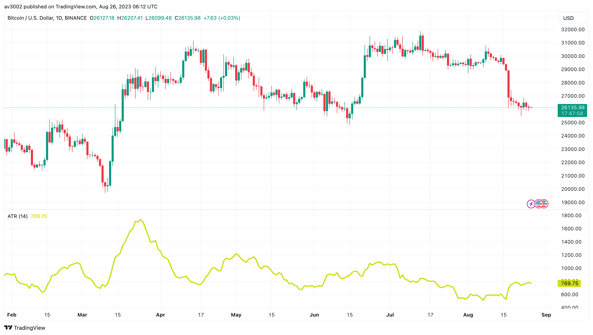
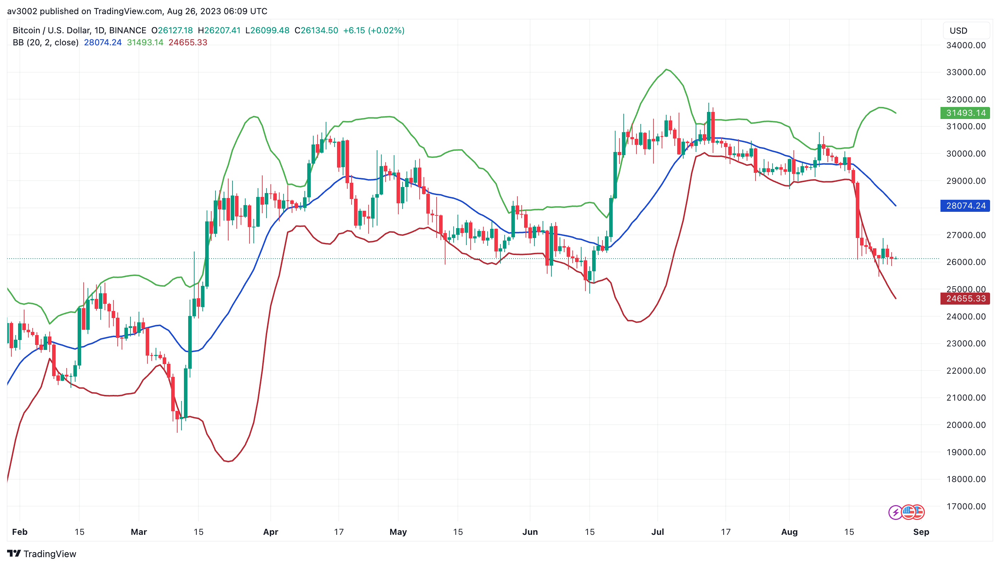
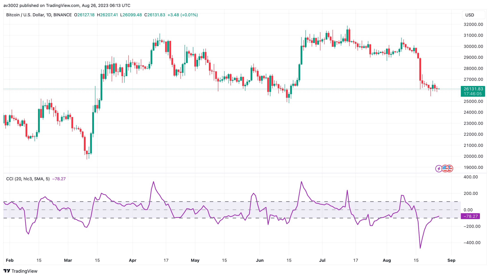
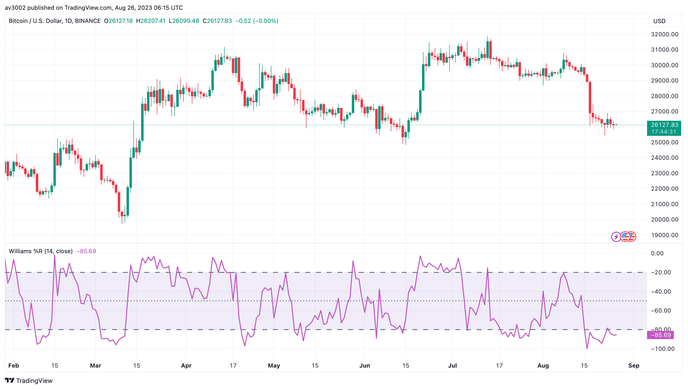

# Pine Strategy Indicators v2

Five open-source TradingView indicators written in Pine Script v6: Average True Range, Bollinger Bands, Commodity Channel Index, Moving Average Convergence Divergence and Williams %R. Part of [GAINZ](https://gainz-trading-indicators.vercel.app), 35 indicators across seven collections.

| Indicator                                                                       | Type       | Script                                                                    |
| ------------------------------------------------------------------------------- | ---------- | ------------------------------------------------------------------------- |
| [Average True Range](#average-true-range)                                       | Volatility | [`average-true-range.pine`](indicators/average-true-range.pine)           |
| [Bollinger Bands](#bollinger-bands)                                             | Volatility | [`bollinger-bands.pine`](indicators/bollinger-bands.pine)                 |
| [Commodity Channel Index](#commodity-channel-index)                             | Momentum   | [`commodity-channel-index.pine`](indicators/commodity-channel-index.pine) |
| [Moving Average Convergence Divergence](#moving-average-convergence-divergence) | Momentum   | [`macd.pine`](indicators/macd.pine)                                       |
| [Williams %R](#williams-r)                                                      | Momentum   | [`williams-r.pine`](indicators/williams-r.pine)                           |

## Average True Range

Measures how far price typically travels in one bar, gaps included.

It says nothing about direction. Use it to size stops and positions: a rising ATR means wider swings and more room to give.

| Setting | Default |
| ------- | ------- |
| Length  | 14      |

## Bollinger Bands

A 20-bar average wrapped in bands two standard deviations wide, with the space between them shaded.

Bands squeeze before big moves and widen during them. Price riding a band is strength, not automatically an exit.

| Setting        | Default |
| -------------- | ------- |
| Length         | 20      |
| Std. deviation | 2.0     |
| Source         | Close   |

Based on TradingView's built-in Bollinger Bands indicator.

## Commodity Channel Index

How far the typical price has strayed from its average, scaled by how far it usually strays.

Above +100 is stretched to the upside, below −100 to the downside. Moves back inside the band often mark the turn.

| Setting   | Default |
| --------- | ------- |
| Length    | 20      |
| Source    | HLC3    |
| Smoothing | SMA 5   |

Based on TradingView's built-in Commodity Channel Index indicator.

## Moving Average Convergence Divergence

The gap between a 12- and a 26-bar EMA, with a 9-bar signal line and a histogram.

MACD crossing its signal line marks a shift in momentum. The histogram shows how much force is behind it.

| Setting  | Default |
| -------- | ------- |
| Fast EMA | 12      |
| Slow EMA | 26      |
| Signal   | 9       |

## Williams %R

Where the close sits against the highest high of the last 14 bars, from 0 down to −100.

Above −20 is overbought, below −80 oversold. The turns out of those zones are the signals.

| Setting | Default |
| ------- | ------- |
| Length  | 14      |
| Source  | Close   |

Based on TradingView's built-in Williams %R indicator.

## How to use

1. Open the indicator's `.pine` file in `indicators/` and copy the code.
2. In TradingView, open the Pine Editor, paste the code and save it.
3. Click **Add to chart**, then change the defaults in the indicator's settings.

## Disclaimer

For learning and research. Indicators describe what price has done, not what it will do. Nothing here is financial advice.

## License

[MIT](LICENSE). Indicators based on someone else's work keep their original author's terms.
